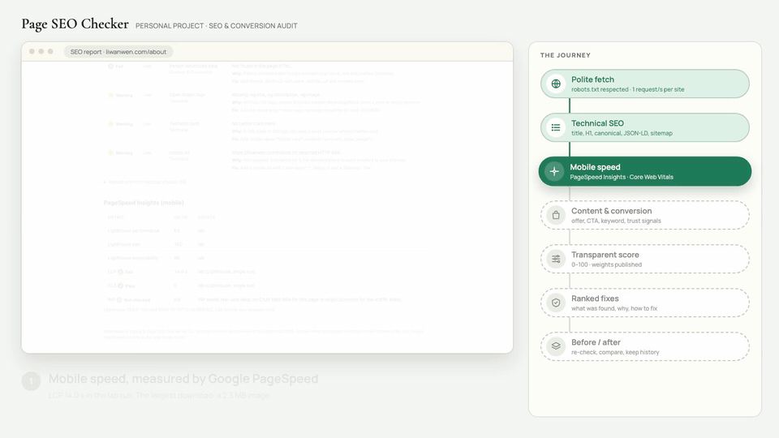

# Listing & Page SEO Checker

**Paste a URL, get a 0–100 score with prioritised fixes for technical SEO, mobile performance and conversion — each issue says what was found, why it matters and how to fix it.**



**51-second walkthrough, example reports and the measured before/after:** [liwanwen.com/seo-checker](https://liwanwen.com/seo-checker/)

### Measured before / after on two live pages

**1. [Petal / Atelier demo shop](https://liwanwen.com/petal/)**: a concept botanical-soap shop from my portfolio, checked as a product page for "botanical soap".

| | Before | After |
|---|---|---|
| Tool score | 78 | 92 |
| Lighthouse mobile (median of 3 → 3 runs) | 66 | 100 |
| LCP (median) | 50.0 s | 1.9 s |
| Page weight | 9,734 KB | 408 KB |

Applied: WebP images, a keyword title that says it is a demo, canonical, sharing tags, WebPage structured data, sitemap entry. **Deliberately not applied:** reviews and Product markup with prices. The shop is fictional, so both would mislead.

**2. My portfolio, [liwanwen.com](https://liwanwen.com/)**: the About page went from Lighthouse 63 → 92 and LCP 14.0 s → 2.4 s (medians); the home page's speed did not measurably change.

Raw data: [`examples/petal-before/`](examples/petal-before/), [`examples/petal-after/`](examples/petal-after/) and [`examples/portfolio-after/`](examples/portfolio-after/). The case study is in [`portfolio/case-study-en.md`](portfolio/case-study-en.md) ([中文](portfolio/case-study-zh.md)). No ranking or traffic claims are made without Search Console data.

## Install

```bash
git clone https://github.com/WANWEN-LI/seo-page-checker.git && cd seo-page-checker
python3 -m venv .venv && source .venv/bin/activate   # Python 3.11+
pip install -r requirements.txt
cp .env.example .env   # then add your PAGESPEED_API_KEY
```

## Usage

### Web UI

```bash
streamlit run app.py        # opens http://localhost:8501
```

There are three tabs:
- **Check pages**: enter up to 10 URLs, plus an optional keyword and page type. You get the scores, the issues sorted by severity, and download buttons for the HTML and JSON reports.
- **Before / after**: pick two saved runs of the same page and see the score changes and which issues were fixed, improved, regressed or are still open.
- **History**: every saved run.

### Command line

```bash
# check, save to history, write a shareable HTML report
python -m seo_checker https://example.com/ --keyword "ceramic vase" --page-type product --save --html report.html

# compare the latest two saved runs of a page (or pass two JSON files)
python -m seo_checker compare --url https://example.com/ --html compare.html
python -m seo_checker compare before.json after.json

# list saved runs
python -m seo_checker history [URL]
```

| Flag | Meaning |
|---|---|
| `--keyword` | target search term; turns on the keyword checks |
| `--page-type` | `product`, `landing` or `portfolio`; decides which trust signals are expected |
| `--save` | store the run in `data/history/<host>/<path>/` for before/after comparison |
| `--html` | write an HTML report (a folder when several URLs are given) |
| `--out` | write the raw JSON report to a file |
| `--no-psi` | skip the PageSpeed Insights call |
| `--no-link-check` | skip the broken-link requests |

### Before / after rules

Runs are matched check by check:
- **Fixed**: a check went from fail or warn to pass.
- **Improved**: fail went to warn.
- **Regressed**: the status got worse.
- **Still open**: the status didn't change and isn't a pass.

A check that is `info` or `not_checked` in either run is left out, so a change is never claimed without two real measurements. The report adds a warning when the URL, keyword or page type differs between the two runs, and it points out that Lighthouse lab scores vary from run to run.

## What it checks

**Technical** (requests + BeautifulSoup): title (present, 30–60 chars, keyword), meta description (70–160 chars), exactly one H1, heading levels not skipped, image alt coverage, canonical, robots meta (noindex), `lang`, Open Graph and Twitter tags, JSON-LD (valid, which `@type`s), internal/external link counts, broken links (4xx, first 50 links), robots.txt, sitemap.xml.

**Performance** (Google PageSpeed Insights API, mobile): Lighthouse Performance, Accessibility and SEO scores; Core Web Vitals LCP, CLS, INP. Real-user (CrUX) field data is used when Google has it, for the page first, then the origin; otherwise lab values from Lighthouse are shown and labelled as lab. INP has no lab equivalent, so it shows as "not checked" when no field data exists.

**Content & Conversion** (listing-optimisation heuristics):
- Value proposition: the H1 appears in the opening section, with supporting copy
- Call to action in the opening section: a button or link with an action verb (nav links don't count)
- Keyword placement in the title, the H1 and the first paragraph
- Readability: words per sentence, paragraph length, Flesch reading ease
- Trust signals by page type:
  - product: price, reviews, shipping and returns, Product schema
  - landing: social proof, contact
  - portfolio: contact, evidence of work, Person schema

## AI suggestions (optional)

Set `ANTHROPIC_API_KEY` in `.env` and pass `--ai` (or tick the box in the UI). The tool then sends Claude (`claude-opus-5-5`) the audit JSON: measured facts, the failing checks, and short excerpts of the page's title, H1 and opening text. It gets back:
- 2–3 rewrites of the title and of the meta description. **The tool counts the characters itself** rather than trusting the model's count.
- Up to 5 fixes ranked by impact ÷ effort. **Each fix must point to a failing check id from the audit**; any fix that doesn't is dropped, and the report shows how many were dropped.

The request opts into Anthropic's server-side refusal fallback (`fallbacks: "default"`). Without a key the tool runs normally and the report says AI suggestions were skipped. Every call is billed by Anthropic to your API key.

## Scoring rules

The rules live in [`seo_checker/scoring.py`](seo_checker/scoring.py); this section mirrors them.

**Points per check:** pass = 1, warn = 0.5, fail = 0. Checks marked `info` or `not_checked` (for example no keyword given, or too little text to judge readability) are left out entirely, so they neither help nor hurt.

**Technical and Content & Conversion:** `score = 100 × Σ(weight × points) / Σ(weight of scored checks)`

| Technical check | Weight | | Content check | Weight |
|---|---|---|---|---|
| Title length / present | 3 | | Value proposition above the fold | 3 |
| Single H1 | 3 | | CTA above the fold | 3 |
| Robots meta (no noindex) | 3 | | Keyword placement | 2 |
| Broken links | 3 | | Readability | 1 |
| Keyword in title | 2 | | Price visible (product) | 3 |
| Meta description | 2 | | Contact path (portfolio, landing) | 3 |
| Image alt text | 2 | | Reviews, shipping & returns, social proof, evidence of work | 2 |
| Canonical | 2 | | Product / Person schema | 1 |
| JSON-LD | 2 | | | |
| sitemap.xml | 2 | | | |
| Heading hierarchy, lang, OG, Twitter card, robots.txt | 1 | | | |

**Performance:** `0.6 × Lighthouse Performance + 0.2 × Accessibility + 0.2 × Lighthouse SEO` (mobile). Core Web Vitals appear as issues but are not scored on top: the Performance score already includes lab LCP and CLS.

**Total:** `0.4 × Technical + 0.3 × Performance + 0.3 × Content & Conversion`. When a category is N/A (for example PageSpeed cannot test a localhost URL), the remaining weights are rescaled to add up to 100% and the report says so. The tool never fills in a missing score.

**Severity** (High / Medium / Low) is shown on every issue to rank fixes. It is separate from the weight above.

## Responsible crawling

- Reads robots.txt and skips any URL it disallows. A robots.txt that returns 5xx or can't be reached means "don't crawl", per RFC 9309.
- Waits at least 1 second between requests to the same host. Requests time out after 10 s.
- Sends no cookies or credentials, so it only sees public pages. A 401 or 403 is reported as "not public", and the tool doesn't try to get past it.
- Checks only the URLs you give it, plus the links on those pages (at most 50 per page). It does not crawl whole sites.

## Limitations

- **No JavaScript rendering.** The tool sees the server-sent HTML. Content injected by JS (for example image galleries loaded from a data file) is invisible to it, and to some crawlers as well.
- **"Above the fold" is approximated** as the first 1,500 characters of visible text, because the page is not rendered at a real viewport size.
- **Readability is scored for English pages only.** Pages with another `lang` show readability as "not checked".
- **Trust-signal words** (shipping, returns, reviews) are matched in English, Italian, French, German, Spanish and Dutch only.
- **Bot-check and queue pages are detected heuristically** (title and text patterns) and not scored. Some challenge pages may slip through, and an unusual real page could be flagged.
- **One page at a time.** Duplicate titles or meta descriptions across pages of the same site are not detected.
- **Lighthouse varies between runs, and PageSpeed caches repeated requests for a short time.** The before/after report compares single runs; for conclusions about speed, take several runs spaced a minute or more apart and compare the medians, as in `examples/portfolio-after/lighthouse-summary.json`.
- **Run it locally.** It fetches whatever URL it is given and has no protection for public hosting (for example against requests to private network addresses).
- **PageSpeed Insights only tests public URLs.** Local or staging pages get Performance = N/A.
- **Without a PageSpeed API key**, Google rate-limits anonymous requests (HTTP 429 seen in testing).
- **Heuristics, not ground truth:** CTA, price and review detection uses keyword and pattern matching, so false positives and negatives are possible. For example, on the IKEA example page an image-zoom button ("…normal view") was counted as a call to action.
- **Out of scope:** keyword search volume, backlinks and rankings, which need paid data. See "Planned" below.

## Implemented / not implemented / planned

**Implemented**

| Feature | Notes |
|---|---|
| Technical SEO checks | title, meta description, H1 and heading order, alt text, canonical, robots meta, lang, OG and Twitter tags, JSON-LD, broken links, robots.txt, sitemap |
| Mobile performance | PageSpeed Insights API; Lighthouse scores and Core Web Vitals, labelled lab or field |
| Content & conversion checks | value proposition, CTA, keyword placement, readability, trust signals by page type |
| Transparent 0–100 score | rules in `scoring.py` and above |
| Reports | self-contained HTML and raw JSON |
| History and before/after | per-check comparison: fixed / improved / regressed / still open |
| Streamlit UI and CLI | `app.py`, `python -m seo_checker` |
| Polite fetching | robots.txt, 1 request/s per host, timeouts, classified errors, bot-check page detection |
| AI suggestions (optional) | implemented and unit-tested with a mocked client; not yet run against the live API in this project |
| Tests | 59 unit tests |

**Not implemented**

| Feature | Why |
|---|---|
| JavaScript rendering | server-sent HTML only, to stay fast and simple |
| Site-wide crawl and cross-page duplicate detection | the tool checks the URLs it is given, by design |
| Hosted public demo | would need SSRF protection, rate limiting and quota control first |
| Pages behind a login | public pages only |

**Planned**

| Feature | Notes |
|---|---|
| Search Console data | real impressions, clicks and queries for liwanwen.com once enough data exists |
| Built-in repeated Lighthouse runs | medians of spaced runs instead of a single run |
| Duplicate title and description detection across a site's pages | |
| Keyword volume, backlinks, rankings | require paid data sources |

## Tests

```bash
python -m pytest
```

## License

MIT
